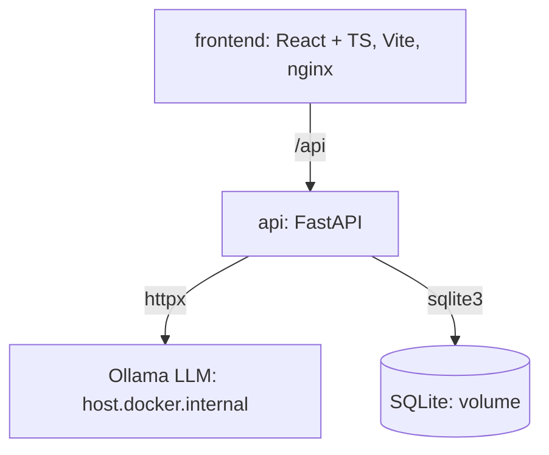

# CardForge

**LLM → structured JSON → ручная правка.** Минимальный fullstack AI-сервис: FastAPI + SQLite + Ollama + React/TS + Docker.

[](https://www.python.org/)
[](https://fastapi.tiangolo.com/)
[](https://react.dev/)
[](https://www.typescriptlang.org/)
[](https://docs.docker.com/compose/)

## What it demonstrates

- **Backend** — FastAPI, Pydantic v2, SQLite, асинхронный вызов LLM через httpx.
- **LLM** — structured output: format=json в Ollama + валидация схемой + до двух повторов при ошибке.
- **Frontend** — React 18 + TypeScript: генерация, просмотр, ручное редактирование полей.
- **Ops** — Docker Compose, healthcheck, CPU-only, без внешних БД и очередей.

## Architecture



## Stack

| Layer | Technology |
|---|---|
| API | FastAPI 0.115, Uvicorn, Pydantic v2 |
| LLM | Ollama (llama3.2), structured JSON |
| DB | SQLite |
| Frontend | React 18, TypeScript 5, Vite 5, nginx |
| Runtime | Docker Compose, CPU-only |

## Quick start

Требования: Docker Desktop, Ollama на хосте, ~2 ГБ RAM для модели.

```bash
git clone https://github.com/DevSpecOps/cardforge.git
cd cardforge
docker compose up -d --build
```

Перед первым запуском на хосте запусти Ollama и скачай модель:

```bash
ollama serve
ollama pull llama3.2
```

UI: http://localhost:8080
API: http://localhost:8000
OpenAPI: http://localhost:8000/docs

## API

| Method | Path | Purpose |
|---|---|---|
| POST | /api/cards/generate | Принять текст, вернуть карточку и ID |
| GET | /api/cards | Список карточек |
| GET | /api/cards/{id} | Детали карточки |
| PATCH | /api/cards/{id} | Сохранить ручные правки |
| GET | /health | Liveness |

## Failure modes

- **Ollama недоступна** — 502 с текстом ошибки, карточка не сохраняется.
- **LLM вернул невалидный JSON** — до двух повторов, затем 502 со структурированной ошибкой.
- **Пустой ввод** — 422 от Pydantic.

## License

MIT