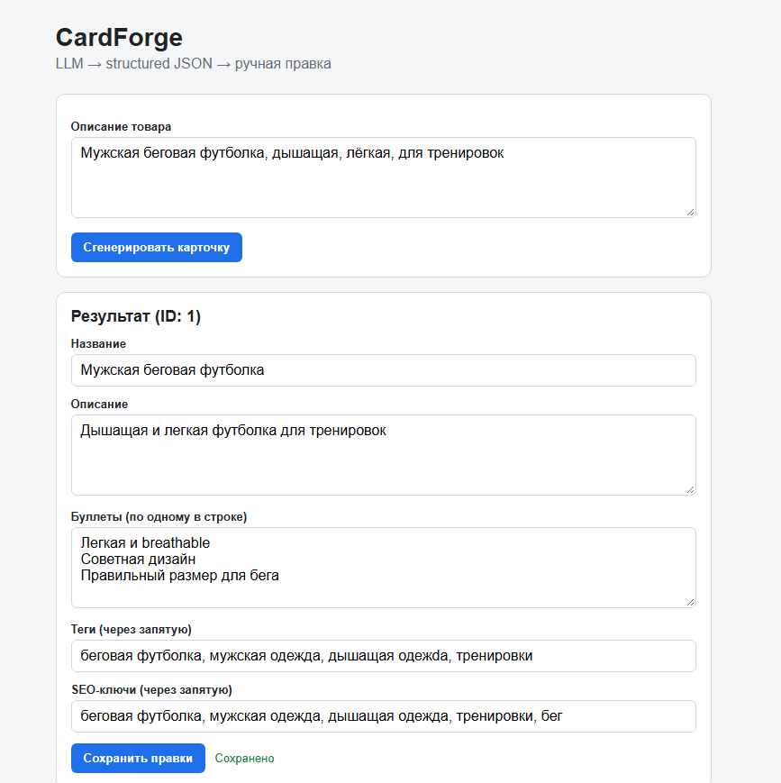
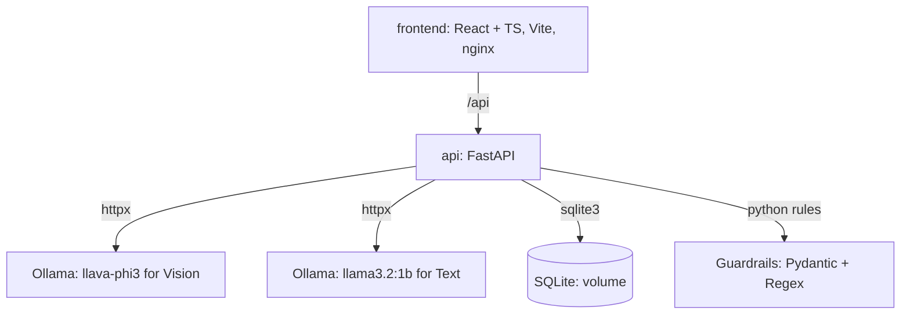

# CardForge

**Multimodal LLM → Structured JSON → Manual Review.** A lightweight, self-hosted fullstack AI service for generating e-commerce product cards.

[](https://www.python.org/)
[](https://fastapi.tiangolo.com/)
[](https://react.dev/)
[](https://www.typescriptlang.org/)
[](https://docs.docker.com/compose/)



## Features

- **Backend** — FastAPI, Pydantic v2, SQLite, asynchronous LLM calls via httpx.
- **Hybrid AI Architecture** — Uses a Vision model (`llava-phi3`) for image analysis and a fast Text model (`llama3.2:1b`) for text rewriting, running inside Docker.
- **Neuro-Symbolic Guardrails** — Python strict rules validate the LLM output. It prevents hallucinations (e.g., blocking body descriptions, replacing unknown brands, and enforcing color/material consistency).
- **Structured Output** — Enforces strict JSON schema via Ollama `format` parameter and Pydantic validation.
- **Image Preprocessing** — Resizes and optimizes images (up to 20MB) via Pillow before sending them to the Vision model.
- **Frontend** — React 18 + TypeScript. Drag & drop upload, dynamic UI states, manual edits, and a PDF export feature.
- **Ops** — Fully containerized with Docker Compose. CPU-only inference, healthchecks included.

## Architecture



## Stack

| Layer | Technology |
|---|---|
| API | FastAPI 0.115, Uvicorn, Pydantic v2 |
| LLM | Ollama (llava-phi3 + llama3.2:1b) |
| Data | SQLite, Pillow (Image Processing) |
| Frontend | React 18, TypeScript 5, Vite 5, nginx |
| Runtime | Docker Compose, CPU-only |

## Quick start

Requirements: Docker Desktop (WSL 2 backend recommended). No local Ollama installation is required — it runs inside Docker.

```bash
git clone https://github.com/DevSpecOps/cardforge.git
cd cardforge
docker compose up -d --build
```

The first run will automatically download the required models (~4.5 GB) into the Docker volume. Once ready:

UI: http://localhost:8080
API: http://localhost:8000
OpenAPI: http://localhost:8000/docs

## API

| Method | Path | Purpose |
|---|---|---|
| POST | /api/cards/generate | Accept text/image, return card |
| GET | /api/cards | List generated cards |
| GET | /api/cards/{id} | Get card details |
| PATCH | /api/cards/{id} | Save manual edits |
| DELETE | /api/cards/{id} | Delete card |
| POST | /api/cards/{id}/enhance | Rewrite text via AI |
| GET | /health | Liveness |

## License

MIT